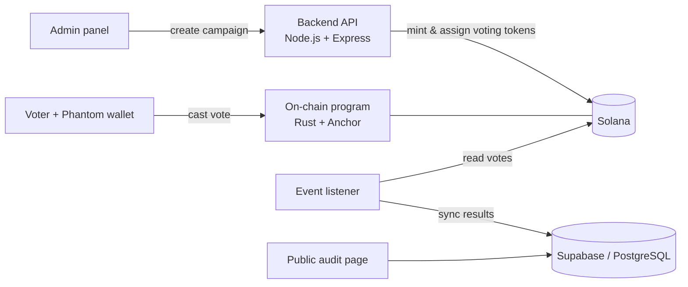

# SHIFT — Blockchain Voting on Solana

**SHIFT** is a voting platform where every vote is recorded on the Solana blockchain. Each eligible voter holds a single voting token, and casting a vote burns that token on-chain, so nobody can vote twice and every result can be audited by anyone.

It was my undergraduate thesis in Information Systems Engineering at Pontificia Universidad Católica del Ecuador (PUCE, 2025). I designed and built the full system: the on-chain program, the backend and the web app.

> The source code is private because I'm developing SHIFT further as a product. I'm happy to walk through the code in a technical interview.

---

## How it works

1. **An administrator creates a campaign** with a title, two or more options and a voting window (start and end time). The campaign lives on-chain in its own account.
2. **Each eligible voter receives one voting token** (an SPL token tied to that campaign) in their Solana wallet.
3. **The voter connects their wallet** (Phantom) and picks an option.
4. **The program checks the vote on-chain**: the campaign is open, the option exists, the token belongs to this campaign and the voter holds it.
5. **The token is burned and the tally goes up**, in the same transaction. Without the token, the wallet cannot vote again.
6. **Anyone can audit the results**: the counts are read from the blockchain and shown in a public results page with charts.

## Architecture

| Part | What it does | Stack |
|---|---|---|
| **Smart contract** | Campaign accounts (PDAs), vote validation, token burn and tally | Rust, Anchor, SPL Token |
| **Backend** | Creates the voting token for each campaign, registers voters and mints their token, listens to on-chain activity and syncs results | Node.js, TypeScript, Express, Solana web3.js, Supabase |
| **Web app** | Admin panel to create campaigns and assign voters, voting page with wallet login, public audit dashboard | Next.js, React, TypeScript, Tailwind, shadcn/ui, Recharts, Solana Wallet Adapter |

## Design decisions

- **One token, one vote.** Instead of storing a list of voters on-chain (expensive and it grows with every voter), eligibility is a token in the voter's wallet, and burning it is the proof that the vote was cast.
- **Rules enforced by the program, not the server.** The voting window, valid options and token checks run inside the Solana program, so a compromised backend cannot change a vote.
- **Off-chain copy for speed, on-chain data as the source of truth.** The listener mirrors results into PostgreSQL so dashboards load fast, while anyone can verify them against the blockchain.

## Status

Working prototype deployed on Solana **devnet**, presented and approved as my thesis in 2025.

---

**Mao Astudillo** — Backend developer · [LinkedIn](https://www.linkedin.com/in/mao-astudillo-067951323)
